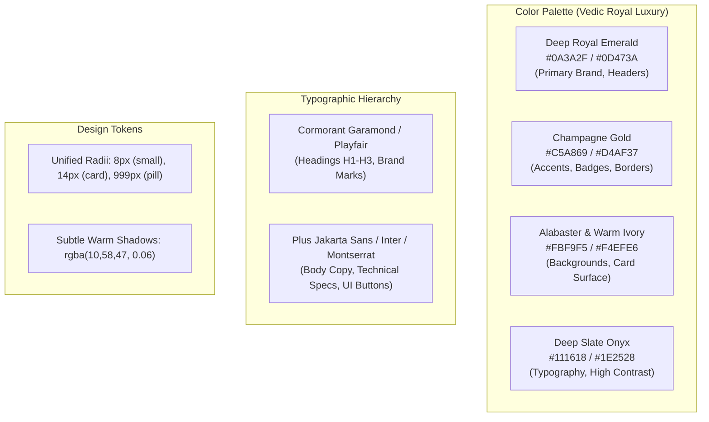
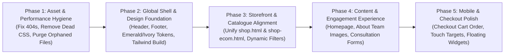

# Gems of Nature V2 — Comprehensive Frontend Audit Before Redesign

**Document Version:** 1.0.0  
**Audit Date:** 2026-10-27  
**Repository:** `~/Desktop/gemsofnature`  
**Active Branch:** `v2-migration`  
**Status:** **Assessment Only (No UI Changes or Source Modifications)**  
**Auditor:** Antigravity AI Senior Frontend & UX Systems Specialist  

---

## 1. Executive Summary & Safety Adherence

### 1.1 Scope and Objective
This audit provides an exhaustive evaluation of the entire frontend architecture, visual presentation, user experience (UX), responsive design, accessibility, and asset hygiene of the **Gems of Nature V2** storefront before any visual redesign or UI refactoring commences.

The objective is to establish an authoritative baseline, distinguish confirmed defects from subjective design enhancements, map all regression hazards, and recommend a phased, non-destructive roadmap to elevate Gems of Nature into a premier luxury gemstone brand while preserving existing business logic, shopping cart compatibility, and payment systems.

### 1.2 Mandatory Safety Compliance Audit
Before starting this assessment, safety constraints were strictly verified:
- **Git Branch:** Verified on `v2-migration` (HEAD: `e17d89a`).
- **Source Code Integrity:** Zero application source files modified. All uncommitted work preserved intact.
- **Payment System Isolation:** Zero payment test suites executed. Zero calls made to Razorpay APIs or simulated checkout endpoints. `tests/unit/payment-integration.test.ts` was untouched.
- **Catalogue & Commercial Truth:** No product inventory, prices, certification credentials, customer testimonials, or staff identities were invented.
- **Inspection Methodology:** All findings in this report are based on deep static analysis of HTML templates, CSS stylesheets, client JavaScript/TypeScript runtime modules, Vite bundler configuration, and DOM element contracts. Findings are explicitly labelled as **code-based inspection**.

---

## 2. Global Architectural & Systemic Findings

Before reviewing individual pages, five critical architectural weaknesses were identified that impact the entire website:

### 2.1 The 404 Stylesheet Reference (`/css/styles.css`)
Across **14 distinct HTML files** (including `shop.html`, `shop-ecom.html`, `checkout.html`, `about.html`, `contact.html`, `astrology.consultation.html`, and 8 guide pages), the following stylesheet link is present:
```html
<link rel="stylesheet" href="/css/styles.css">
```
- **Confirmed Defect:** The file `css/styles.css` **does not exist** in the workspace. Every page load triggers an immediate HTTP 404 network failure. In `tests/integration/runtime-server.test.ts`, this asset is explicitly tracked as an unresolved legacy V1 asset.
- **User Impact:** Unnecessary network overhead, failed resource warning in DevTools console, and potential layout instability.

### 2.2 Production Reliance on Tailwind Play CDN (`cdn.tailwindcss.com`)
Every single HTML entry point loads the uncompiled Tailwind CSS CDN script:
```html
<script src="https://cdn.tailwindcss.com"></script>
```
- **Confirmed Defect:** The Tailwind Play CDN runtime is strictly intended for prototyping. In production:
  1. It injects a ~350 KB unminified script that compiles utility classes on the fly in the browser using a `MutationObserver`.
  2. It generates a noticeable **Flash of Unstyled Content (FOUC)** on initial load, especially on mobile networks.
  3. It emits console warnings (`cdn.tailwindcss.com should not be used in production`).
  4. Styles cannot be purged, tree-shaken, or cached effectively.

### 2.3 Client-Side Layout Injection via `layout.js`
Navigation (`#header`) and footer (`#footer`) elements are rendered via asynchronous client-side `fetch()` in `js/layout.js`:
```javascript
const res = await fetch(path, { cache: "no-cache" });
container.innerHTML = html;
```
- **Confirmed Weakness:**
  1. Header and footer HTML files are fetched with `cache: "no-cache"`, forcing repeat network roundtrips on every page transition.
  2. Because `#header` is initially an empty `<div id="header"></div>`, the page layout jumps dramatically when the 432-line `header.html` is injected.
  3. Inline scripts inside `header.html` use nested `setTimeout` loops (at 200ms, 800ms, 1400ms) to measure header height and apply `.header-is-fixed` to the `<html>` root, causing visible cumulative layout shift (CLS).
  4. `js/script.js` uses an active `setInterval` (polling every 100ms) waiting for the `#mobile-menu-button` DOM node to appear before attaching events.

### 2.4 Orphaned and Mismatched Mobile Stylesheets
Analysis of the `css/` directory revealed dead code and filename discrepancies:
- `css/header-mobile.css` (128 lines): **0 references in any HTML file** (completely orphaned).
- `css/footer-mobile.css` (160 lines): **0 references in any HTML file** (completely orphaned).
- `css/gonresponsive.css` (contains a visual test overlay `body::after { content: "DESKTOP VIEW"; }`): Superseded by `css/gon-responsive.css` but still present in the directory.
- `css/gon-responsive.css` exists to patch mobile Rudraksha cards, but is loaded alongside individual mobile stylesheets (`index-mobile.css`, `shop-ecom-mobile.css`, `checkout-mobile.css`), leading to cascading specificity collisions.

### 2.5 Extreme Visual Palette and Typographic Dissonance
The site lacks a unified design token architecture:
- **Header & Footer Background:** Both `header.html` and `footer.html` feature a fixed pastel gradient:
  `linear-gradient(90deg, #F3E3CB 0%, #D7EDEB 30%, #B5E2F1 65%, #89C4E8 100%)` (warm cream, soft mint, ice blue, sky blue).
- **Page Bodies:** The body of each page uses sharp high-contrast dark greens (`#034C3C`, `#065f46`, `#0f9d67`), warm golds (`#D4AF37`), slate grays (`#181d1c`, `#111827`), and pure white backgrounds.
- **Font Stack Clashes:**
  - `header.html` specifies Cormorant Garamond, Playfair Display, Cinzel, and an undeclared Poppins font, plus an embedded GreatVibes font (`GreatVibes-Regular.ttf`).
  - `footer.html` specifies Cormorant Garamond.
  - Page bodies across all HTML files load Montserrat (`Montserrat:wght@400;500;600;700`).
  - Result: Classical editorial serif header and footer sandwiching a geometric modern sans-serif body, creating disjointed brand perception.

---

## 3. Comprehensive Page-by-Page Audit

An audit was conducted across all 21 HTML files in the repository.

### 3.1 `index.html` (Homepage)
- **Purpose & Target Audience:** Primary storefront landing page for spiritual seekers, astrology clients, gemstone connoisseurs, and retail gift buyers.
- **Layout & Visual Hierarchy:**
  1. *Hero Section:* Split-screen layout. Left side text ("Buy Certified Natural Gemstones & Rudraksha Online") with CTA buttons ("Shop Collections", "Free Consultation"). Right side image slider with reflective mirror effect (`#hero-reflection`).
  2. *Interactive Discovery & Collections:* Two-column block. Left column contains a 3-step quiz ("Find Your Perfect Gemstone") with dynamic result cards. Right column contains 4 collection cards (Healing Stones, Zodiac Gems, Bracelets, Raw Stones).
  3. *Featured Rudraksha:* Showcase of 1–10 Mukhi Nepali Rudraksha beads plus malas and bracelets.
  4. *Authenticity & Lab Reports:* Trust credentials, lab report preview modal, and consultation trigger.
- **Typography, Colors & Buttons:** Montserrat text; button colors switch between `#0f9d67` (hero green), `#034C3C` (pine green), `bg-gray-600`, and `bg-gray-800`.
- **Scripts & Dependencies:** Contains over **870 lines of inline JavaScript** (lines 893–1763) managing hardcoded `fallbackRecProducts`, custom quiz state, carousel crossfading, modal dialogs, and a local duplicate cart.
- **Confirmed Defects & UX Issues:**
  1. Massive inline script overhead (1763 total lines).
  2. Right-side collections grid uses hardcoded inline styles and negative margins to align with the left quiz block.
  3. Broken image references: the sample report modal links to `/files/sample-lab-report.pdf`, which is a dummy static file.
  4. Testimonials or customer reviews: completely absent (clean state; no fabricated reviews exist).
  5. Floating widgets overlap: WhatsApp floating button (`bottom-5 right-6`) collides with AI Chat widget (`bottom-24 right-6`) on mobile viewports.

### 3.2 `shop.html` (Collections Catalog) vs `shop-ecom.html` (E-Commerce Storefront)
A major point of confusion for customers is the coexistence of two competing shop pages:

| Dimension | `shop.html` ("Collections") | `shop-ecom.html` ("Buy Online") | Evaluation / Conflict |
| :--- | :--- | :--- | :--- |
| **Nav Header Link** | "Collections" (`/shop.html`) | "Buy Online" (`/shop-ecom.html`) | Users are offered two separate shopping entry points in the top nav. |
| **Category Navigation** | Horizontal pill tabs (`#categoryTabs`) | Dropdown + Pill buttons (`#category-filter`) | Inconsistent UI controls for category selection. |
| **Filtering Capabilities** | Basic text search + price/name sort only | Advanced: Price, Price/Carat, Carat Weight, Ratti Weight, Certification, Origin | `shop.html` lacks gemstone-specific filters. |
| **Multi-Currency** | INR only (`₹`) | INR, USD, EUR, GBP via `gn-currency.js` | Currency conversion works on `shop-ecom.html` but is broken/absent on `shop.html`. |
| **Product Detail View** | Simplified `quickModal` with limited specs | Rich slide-out drawer (`#product-detail`) with 4Cs, lab certification, origin, mantra, and benefits | `shop-ecom.html` provides far superior trust and gemological disclosures. |
| **Pricing Transparency** | Displays `price_min` without provisional warnings | Full disclosure: Provisional price estimate badge vs Confirmed Lot price | `shop.html` risks misleading users by omitting provisional price notices. |
| **Purchase Actions** | Inquire / View only | Add to Cart + WhatsApp Inquiry + Inventory Status | Incompatible cart flows. |

- **Recommendation:** Do not delete either page during audit. In future redesign phases, unify the product card design, dynamic filter engine, and modal drawer across both pages, or designate `shop.html` strictly as an editorial showcase linking into `shop-ecom.html`.

### 3.3 `checkout.html` (Cart & Multi-Region Checkout)
- **Purpose & Target Audience:** Final checkout funnel for domestic Indian customers and international quote requesters.
- **Layout & Structure:**
  - 1494 lines containing two primary phases: Cart review and Shipping/Payment form.
  - Domestic workflow: Computes ₹200 flat shipping, validates phone/address, invokes Razorpay Checkout SDK.
  - International workflow: Replaces instant checkout with a quote inquiry submission (`POST /api/quotes`) returning a customer tracking token.
  - Provisional item protection: Automatically disables instant checkout if any cart item has provisional pricing status.
- **Confirmed UX Defects:**
  1. *Mobile Column Order Reversal:* In `css/checkout-mobile.css` line 31:
     `body[data-page="checkout"] #cart-layout aside { order: -1; }`
     On mobile devices, the Order Summary (subtotal, shipping, "Go to Checkout Details") is pushed to the top of the screen *above* the cart items list. A customer must scroll down past the checkout button to see what is in their cart.
  2. *Visual Density:* Long checkout form with excessive vertical scrolling on mobile.
- **CRITICAL REDESIGN NON-GOAL:** All form IDs, cart state listeners (`gon_cart`), provisional price locks, ₹200 domestic calculation, international quote trigger, and Razorpay event handlers **MUST NOT BE ALTERED**.

### 3.4 `about.html` (Brand Story & Values)
- **Purpose & Target Audience:** Builds trust with first-time buyers through ethical sourcing transparency and founder narrative.
- **Confirmed Defects:**
  1. *Broken Team Avatars:* Lines 303, 313, and 323 reference:
     - `images/team-param.jpg`
     - `images/team-2.jpg`
     - `images/team-3.jpg`
     All three images **do not exist on disk** and return HTTP 404, rendering broken image placeholders for Paramjeet Singh, Rupinder Kaur, and Vishal Sadh.
  2. *Unverified Stat Counters:* The page displays "5000+ Orders across India & abroad" and "100+ Gemstone & bead varieties" as static text blocks without customer proof or verified badges.
  3. *Missing Stylesheet:* References `/css/styles.css` (404).

### 3.5 `contact.html` (Support & Inquiries)
- **Purpose & Target Audience:** Pre-sale gemstone consultation inquiries, customer care, and physical showroom location.
- **Confirmed Defects:**
  1. *Third-Party Formspree Dependence:* Line 220:
     `<form id="contact-form" action="https://formspree.io/f/xdkyozjp" method="POST">`
     The form bypasses our Cloudflare Worker backend and sends customer data to a third-party Formspree endpoint, conflicting with the verified D1 inquiry architecture (`POST /api/inquiries`).
  2. *Embedded Google Map:* Injected via unoptimized iframe string in inline script.
  3. *Missing Stylesheet:* References `/css/styles.css` (404).

### 3.6 `astrology.consultation.html` (Astrology & Planetary Gemstones)
- **Purpose & Target Audience:** Vedic astrology clients seeking horoscope-based gemstone prescriptions and Rudraksha matching.
- **Confirmed Defects:**
  1. *Broken Image Reference:* Line 694 references `images/grs.png` (GRS lab logo), which does not exist and returns HTTP 404.
  2. *Hero Background Alias:* Line 362 references `url('/images/hero.jpg')`. `images/hero.jpg` does not exist in `images/` (only `hero-bg.jpg` exists). It only resolves in production because `vite.config.ts` creates a build copy.
  3. *Form Duplication:* Contains two separate consultation forms on the same page:
     - Quick Booking Hero Form (`#quick-form`)
     - Embedded Consultation Form (`#gn-embed-form`)
     Both forms capture similar fields (name, DOB, time of birth, place of birth, concern) with different styling, confusing visitors.
  4. *Missing Stylesheet:* References `/css/styles.css` (404).

### 3.7 `owner.html` (Private Owner Dashboard)
- **Purpose & Target Audience:** Internal administrative portal for inventory intake, shipping quote approvals, and customer inquiry review (restricted to site owner).
- **Evaluation:**
  - Modern, functional Tailwind dashboard completely segregated from public storefront styles.
  - Implements volatile in-memory authentication (`OWNER_ADMIN_KEY`), CSV preview/import with row-level error maps, and audit logs.
  - **Verdict:** Highly functional and secure. Should be excluded from public-facing visual redesigns to prevent administrative disruption.

### 3.8 `terms-and-conditions.html` (Root Stub) vs `guides/terms-conditions.html`
- **Confirmed Defect:** At the project root, `terms-and-conditions.html` is an unstyled 25-line raw HTML stub containing `Last updated: Today` and basic text without header, footer, or CSS. It has a canonical link pointing to `https://www.gemsofnature.shop/guides/terms-conditions.html`.
- **Verdict:** Search engines or users accessing `/terms-and-conditions.html` see an unstyled broken page.

### 3.9 Educational & Policy Guides (`guides/*.html`)
The 10 guide pages provide high-value content for Vedic astrology, Rudraksha mukhi guides, and shipping policies:
1. `guides/gemstone-basics.html`
2. `guides/how-to-choose.html`
3. `guides/chakras-stones.html`
4. `guides/rudraksha-guide.html`
5. `guides/how-to-wear-care.html`
6. `guides/faq.html`
7. `guides/shipping-policy.html`
8. `guides/returns-refunds.html`
9. `guides/privacy-policy.html`
10. `guides/terms-conditions.html`

- **Strengths:** Accurate educational copy, genuine Vedic references, explicit disclosure of the ₹200 domestic shipping fee and international quote-first flow.
- **Weaknesses:**
  - Every single guide page references the missing `/css/styles.css` (404).
  - Uses inconsistent max-width wrappers (`max-w-7xl` vs `container mx-auto px-6` vs `max-w-5xl`).
  - Text typography uses plain unstyled lists with standard bullet points rather than premium editorial formatting.

---

## 4. Mobile UX & Responsive CSS Audit

### 4.1 Viewport Breakpoint Inconsistencies
The site uses conflicting responsive breakpoints across different files:
- **Tailwind Defaults:** `sm: 640px`, `md: 768px`, `lg: 1024px`, `xl: 1280px`.
- **Custom Header CSS:** Breakpoints defined at `1400px`, `1200px`, `980px`, and `768px`.
- **Mobile CSS Files:** Hardcoded to `@media (max-width: 768px)`.
- **Rudraksha Patch (`gon-responsive.css`):** Hardcoded to `@media (max-width: 480px)`.
- **Config file (`js/gn-config.js`):** Defines `mobileMax: 767`, `tabletMax: 1023`.

This fragmentation results in subtle layout breakage between 768px and 980px (e.g. tablet portrait and small laptop displays), where desktop navigation items wrap onto multiple lines and overlap the logo before the hamburger menu engages.

### 4.2 Touch Targets & Mobile Usability
- **Header Elements:**
  - Hamburger toggle (`#mobile-menu-button`) has adequate hit area, but lacks visual focus ring.
  - Cart button (`#headerCartBtn`) uses an emoji `🛒` with an absolute positioned badge that partially overlaps the icon.
- **Filter Pills (`shop-ecom.html`):**
  - Height is ~32px with `padding: 0.4rem 0.95rem; font-size: 0.8rem`. Fails WCAG 2.1 AAA touch target minimum (44x44px).
  - Arrow icons (`&#9662;`) are tiny (0.55rem–0.6rem) and difficult to tap accurately on small mobile screens.
- **Modal Drawers:**
  - The product detail modal on mobile (`bottom-0 w-full max-h-[92vh] rounded-t-3xl`) operates as a bottom sheet. However, when scrolling internal product benefits, accidental drag gestures can interfere with browser address bar toggling.

---

## 5. Existing Design System Audit vs Recommended Premium Target

### 5.1 Current Design System Audit

| Token / Element | Current Implementation | Critique / Defect |
| :--- | :--- | :--- |
| **Primary Color** | Inconsistent: `#0f9d67`, `#034C3C`, `#065f46`, `#0f6b4f`, `emerald-600` | No single primary brand color; visual identity feels haphazard. |
| **Secondary / Accent** | `#D4AF37`, `#E8DCC2`, `amber-600`, `#07a66a` | Gold is used sparingly and inconsistently; clashes with lime/bright greens. |
| **Header/Footer BG** | Pastel gradient (`#F3E3CB` to `#89C4E8`) | Resembles baby/nursery pastel hues rather than high-jewelry luxury. |
| **Primary Typography** | Montserrat (`sans-serif`) across body | Clean but lacks the prestige and heritage of high-end jewelry houses. |
| **Display Typography** | Cormorant Garamond, Playfair Display, GreatVibes in header | High-quality serif fonts exist but are confined to header/footer fragments. |
| **Card Borders & Shadows** | Mixed: `shadow-md`, `shadow-2xl`, `border-gray-100`, `border-emerald-200` | Inconsistent elevation and border radius (ranges from 8px to 24px). |
| **Buttons & Badges** | Rounded-full pills, rounded-xl boxes, black `#1a1a1a`, emerald `#059669` | Five different button shapes and colors used on the same page. |

### 5.2 Recommended Luxury Design System Foundation

To convey authenticity, Vedic heritage, and high gemological value, a restrained, unified design system should be established:



1. **Brand Colors:**
   - **Primary Surface / Identity:** Deep Royal Emerald (`#0A3A2F` / `#0D473A`) — evokes natural emeralds, spiritual depth, and regal heritage.
   - **Prestige Accent:** Antique / Champagne Gold (`#C5A869` / `#D4AF37`) — used sparingly for verified badges, borders, and subtle highlights.
   - **Canvas & Backgrounds:** Warm Ivory / Fine Alabaster (`#FBF9F5`, `#F4EFE6`) replacing harsh pure whites and jarring pastel gradients.
   - **Body & Text:** Deep Slate Onyx (`#111618`, `#232B2E`) providing optimal contrast and readability.
2. **Typography Pairing:**
   - **Headings (H1–H3):** Classical serif (*Cormorant Garamond*) with graceful proportions and editorial authority.
   - **Body, UI, & Data Tables:** Crisp, clean sans-serif (*Plus Jakarta Sans* or *Montserrat*) for legibility in product specs, carat weights, and pricing.
3. **Component Standardization:**
   - Consistent card border radius (`rounded-2xl` / 16px).
   - Uniform input and button heights (48px primary, 40px secondary) with WCAG AAA touch targets.

---

## 6. Design & UX Scorecard

*Ratings reflect an expert heuristic assessment on a scale of 1 to 10 based on source code analysis and UX best practices:*

| Evaluation Dimension | Score (1–10) | Evidence-Based Assessment |
| :--- | :---: | :--- |
| **Visual Design** | **5 / 10** | High-quality gemstone product photography is undercut by mismatched pastel header/footer gradients, competing button colors, and inconsistent card styles. |
| **Brand Consistency** | **4 / 10** | Dissonance between serif header, modern body, and multiple competing green/gold hues across pages. Two separate shop pages dilute brand focus. |
| **Navigation & IA** | **5 / 10** | "Collections" vs "Buy Online" split creates user hesitation. Mobile menu drops into a dark slate box that clashes with the pastel header bar. |
| **Product Discovery** | **7 / 10** | `shop-ecom.html` features an impressive dynamic filter system (carat, ratti, origin, lab, price). Homepage gemstone quiz provides quick personalization. |
| **Product Detail UX** | **7 / 10** | Rich product details in `shop-ecom.html` (gemological attributes, mantra, deity, benefits). Weakened by lack of full multi-image gallery or zoom. |
| **Mobile Usability** | **5 / 10** | Mobile CSS overrides use `!important` flags; checkout summary is placed above cart items; floating WhatsApp and Chat widgets collide at bottom-right. |
| **Accessibility (a11y)** | **4 / 10** | Screen-reader skip link points to `#main` which is missing on major pages; filter buttons under 44px; invalid ARIA menubar role in header navigation. |
| **Performance Hygiene** | **4 / 10** | Play CDN (`cdn.tailwindcss.com`) used in production; missing `/css/styles.css` (404); uncompiled 870-line inline script on homepage; dynamic `fetch()` header injection. |
| **Customer Trust** | **6 / 10** | Positive: genuine Vedic knowledge, authentic origin rules, ₹200 flat shipping. Negative: broken team images on `about.html`, broken GRS logo on consultation page. |
| **Conversion Clarity** | **6 / 10** | Checkout funnel clearly separates domestic vs international quote workflows. However, dual shop pages and Formspree contact form reduce conversion trust. |

**Overall Heuristic Score:** **5.3 / 10**

---

## 7. Frontend Architecture, Dependencies & Regression Risks

### 7.1 Architecture Breakdown

```mermaid
graph TD
    HTML[21 HTML Pages] --> LayoutJS[js/layout.js: fetch header & footer]
    LayoutJS --> Header[header.html + mini-cart]
    LayoutJS --> Footer[footer.html]

    HTML --> TailwindCDN[cdn.tailwindcss.com (Runtime Scan)]
    HTML --> MissingCSS[/css/styles.css (HTTP 404)]
    HTML --> MobileCSS[css/*-mobile.css (Page specific)]

    HTML --> CoreJS[js/products.js & js/product-meta.js]
    CoreJS --> ShopEcom[shop-ecom.html: Dynamic Filters & Detail Panel]
    CoreJS --> Checkout[checkout.html: LocalStorage gon_cart & Razorpay]

    Build[Vite Bundler] --> Dist[dist/ Assets Output]
    TypeScript[src/client/ & src/core/] --> CoreBundle[dist/gemsofnature-core.js]
```

### 7.2 Strict Regression Hazards (What Must NOT Be Broken)

During any future UI redesign, the following technical mechanisms are critical to preserve:

1. **LocalStorage Cart Schema (`gon_cart`):**
   - The cart storage key is `gon_cart`, structured as an object of `{ [productId: string]: number }`.
   - Any markup change must preserve input IDs, data attributes (`data-product-id`), and cart count badges (`#cartCount`, `#cartCountLabel`).
2. **Provisional Price Safeguards:**
   - Products with provisional prices (`p101`, `p102`, etc. when physical stock is not locked) must **never** be allowed to complete instant checkout.
   - The UI must continue to render the required inquiry disclaimer and lock the "Add to Cart" or "Instant Buy" button.
3. **Domestic ₹200 Flat Shipping Rule:**
   - Domestic shipping calculation inside `checkout.html` and `src/cart/price-calculator.ts` strictly applies ₹200. Do not alter shipping cost display formulas.
4. **International Quote-First Workflow:**
   - If an international country is selected, the checkout button transforms into a Quote Request trigger submitting to `POST /api/quotes`.
   - This flow requires the customer email, destination address, and returns a customer access token (`cat_...`). Do not remove or alter quote submission inputs.
5. **Payment Integration Handlers:**
   - Razorpay checkout event listeners, signature validation, and failure callbacks in `checkout.html` must remain strictly intact.

---

## 8. Prioritized Implementation Roadmap

The frontend improvements are structured into five sequential phases to ensure zero operational disruption and complete regression safety:



### Phase 1: Asset Hygiene & Performance Foundation (Priority: CRITICAL)
- **Goal:** Eliminate network 404 errors, purge orphaned stylesheets, and establish reliable asset paths.
- **Actions:**
  1. Remove `<link rel="stylesheet" href="/css/styles.css">` from all 14 HTML files, or create a clean baseline stylesheet.
  2. Fix broken image references: update `about.html` team avatars (or use elegant branded silhouette badges if real photos are pending) and remove broken `images/grs.png` from `astrology.consultation.html`.
  3. Purge orphaned files `css/header-mobile.css` and `css/footer-mobile.css`, or integrate their rules cleanly.
  4. Link or redirect the root `terms-and-conditions.html` stub to `guides/terms-conditions.html`.
- **Regression Risk:** Minimal (purely additive/hygiene).

### Phase 2: Design System Tokens & Shared Layout Shell (Priority: HIGH)
- **Goal:** Replace jarring pastel gradients with the Royal Emerald & Warm Ivory luxury palette across header and footer.
- **Actions:**
  1. Define global CSS custom properties in a unified stylesheet (`--gon-emerald-900`, `--gon-gold-500`, `--gon-ivory-50`, `--gon-font-serif`, `--gon-font-sans`).
  2. Redesign `header.html`: elegant luxury navigation, prominent search, clear cart counter, accessible mobile drawer.
  3. Redesign `footer.html`: replace pastel gradient with deep emerald slate, add authentic trust badges (GIA/IGI/GJEPC), update copyright to 2026.
  4. Fix skip link accessibility by ensuring every page has `<main id="main">`.
- **Regression Risk:** Low. Shared layout changes must preserve `#headerCartBtn`, `#cartCount`, `#mobile-menu-button`, and `#cartPopup`.

### Phase 3: Catalogue & Product Experience Alignment (Priority: HIGH)
- **Goal:** Eliminate customer confusion between `shop.html` and `shop-ecom.html`.
- **Actions:**
  1. Clarify role: designate `shop.html` as the curated "Collections & Edits" gateway and `shop-ecom.html` as the "Complete Gemstone & Rudraksha Catalogue".
  2. Standardize product cards: identical typography, image aspect ratio (1:1 or 4:5), and price display.
  3. Ensure both pages share the same robust slide-out product detail drawer with 4Cs, origins, mantras, and provisional price disclosures.
  4. Support multi-currency formatting on all collection cards via `gn-currency.js`.
- **Regression Risk:** Medium. Must preserve `window.products`, catalogue IDs, and inventory status badges.

### Phase 4: Homepage & Content Storytelling Polish (Priority: MEDIUM)
- **Goal:** Transform the homepage into an immersive, high-converting luxury experience.
- **Actions:**
  1. Refine Hero Section: high-impact gemstone visual, crisp editorial headline, clear dual CTAs.
  2. Move the 870 lines of inline JavaScript from `index.html` into a modular script (`js/home-recommender.js`).
  3. Polish Rudraksha and Gemstone Authenticity sections with high-clarity cert sample triggers.
  4. Consolidate consultation booking on `astrology.consultation.html` into a single, high-trust Vedic intake form.
  5. Migrate `contact.html` from Formspree to internal Cloudflare Worker customer inquiry endpoint.
- **Regression Risk:** Low to Medium.

### Phase 5: Mobile UX, Checkout Polish & Floating Widget Orchestration (Priority: MEDIUM)
- **Goal:** Optimize mobile conversion and eliminate widget collision.
- **Actions:**
  1. Fix mobile checkout layout: ensure "Items in Cart" is visible *above* the Order Summary on small screens.
  2. Reposition floating action buttons: combine WhatsApp and Assistant into a single coordinated floating dock to prevent screen blocking.
  3. Ensure all mobile touch targets meet the 44x44px standard.
  4. Streamline checkout address inputs for mobile autofill.
- **Regression Risk:** High attention required for `checkout.html` to avoid touching Razorpay or quote request handlers.

---

## 9. Explicit Non-Goals (Scope Boundaries)

During the upcoming visual and frontend redesign:
- **NO Backend Changes:** Cloudflare Worker routing (`src/worker.ts`), D1 storage schemas (`migrations/`), and service validation (`src/backend/service.ts`) remain untouched.
- **NO Payment Modifications:** Razorpay order creation, checkout verification, webhook processing, and secret handling remain strictly out of scope.
- **NO Inventory Inventory Fabrication:** No fake gemstone lots, mock carat weights, or provisional prices will be invented.
- **NO Business Rule Alterations:** The ₹200 flat domestic shipping fee, international quote-first approval requirement, and provisional-stone purchase block must remain completely intact.
- **NO Owner Portal Reskinning:** `owner.html` is an internal operations tool and will not be burdened with consumer luxury storefront styling.

---

## 10. Final Recommendation: First Implementation Phase

### Recommended Phase: **Phase 1 (Asset Hygiene & Performance Foundation)** followed immediately by **Phase 2 (Design System Tokens & Shared Layout Shell)**.

### Why This Must Come First:
1. **Network Cleanliness:** Eliminating the missing `/css/styles.css` (404) across 14 pages and resolving broken team/lab image references immediately improves developer experience, test runner cleanliness, and page load reliability.
2. **Instant Visual Transformation:** The header and footer are rendered dynamically on *every single page* of the website. Replacing the dated pastel baby-blue gradient with the Royal Emerald & Warm Ivory palette instantly transforms the perceived quality and prestige of the entire website without touching delicate page-specific logic.
3. **Zero Business Logic Risk:** Updating the layout fragments (`header.html`, `footer.html`) and asset links carries virtually zero risk of impacting cart state, provisional inventory rules, or checkout processing.

---
*Report generated and archived at `docs/audits/STAGE_5_FRONTEND_AUDIT.md`.*  
*Ready for user review and approval prior to beginning Phase 1 implementation.*
